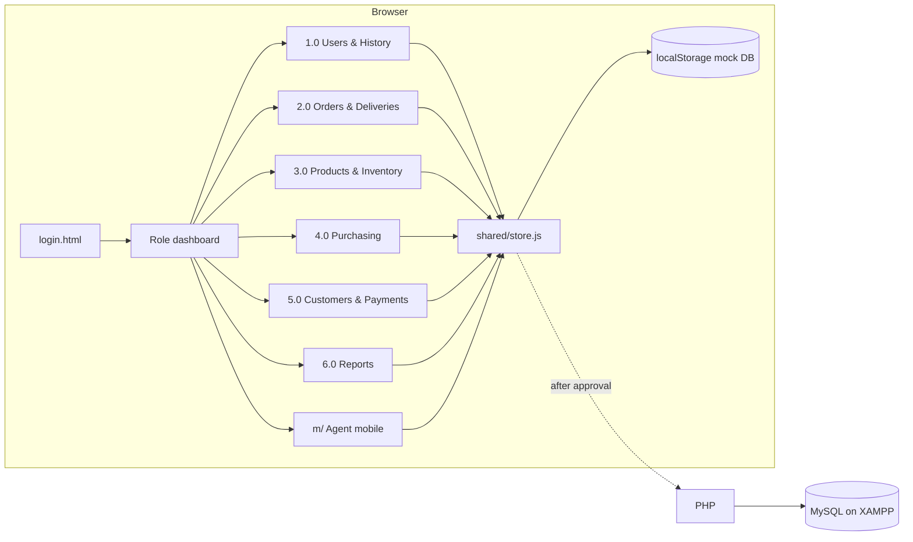

# Centennial Sales & Inventory Prototype — Architecture

> Generated on 2026-10-23, updated 2026-10-25 | Moment: **validate**. This is a clickable prototype that Centennial reviews in 3 sessions (Modified Waterfall, Phase 2: System Design). All modules are built; the current step is a visual polish pass before the review sessions (ADR-006).

## Summary

The prototype is a static, multi-page web prototype: plain HTML, CSS and JavaScript, with mock data kept in `localStorage`, and nothing to install or host. Its job is to let Centennial's staff and agents click through every planned module and approve the design. The real system comes after approval and is built with PHP and MySQL on XAMPP, as Chapter 3 states. The prototype's mock data follows the ERD's table names so it carries over.

## Alignment Score

```
📊 Dimension Extraction — 9/9 dimensions confident

  project_moment   ██████████ validate  (0.95) ✓  "prototype reviewed in 3 sessions until approved"
  product_type     ██████████ web       (0.95) ✓  "web-based"; desktop for office, mobile for agents
  team_size        ██████████ 5         (0.95) ✓  "team of 5"
  user_scale       █████████░ lt_1k     (0.90) ✓  one company, 3 branches, office staff + field agents
  monthly_budget   ████████░░ free      (0.85) ✓  student capstone, local XAMPP
  needs_realtime   ████████░░ false     (0.80) ✓  alerts can refresh on page load
  access_pattern   ████████░░ balanced  (0.80) ✓  orders and stock writes; lists and reports reads
  has_offline      ███████░░░ false     (0.75) ✓  agents use mobile data; autosave covers drops
  latency_critical ████████░░ false     (0.85) ✓  just needs to be "fast, unlike the 2010 system"

  ✓ = confidence >= 0.7
```

## Architecture Diagram (ASCII)

```
 ┌──────────────── Browser (desktop: office roles · mobile: Sales Agent) ────────────────┐
 │  login.html ─► dashboard.html (per role)                                              │
 │     │                                                                                 │
 │     ├─ users/ history/    (1.0)   ├─ products/ stock/ (3.0)   ├─ customers/ payments/ (5.0) │
 │     ├─ orders/ deliveries/ (2.0)  ├─ purchasing/      (4.0)   ├─ reports/            (6.0) │
 │     └─ m/  (agent mobile pages)                                                       │
 │                                                                                       │
 │  shared/: tokens.css · layout.css · components.css                                    │
 │           store.js (mock DB) · auth.js · history.js · autosave.js · format.js        │
 │                         │                                                             │
 │                         ▼                                                             │
 │            localStorage "centennial-db" (seeded from data/seed.js)                    │
 └───────────────────────────────────────────────────────────────────────────────────────┘
        later (after approval) ─► PHP pages/API ─► MySQL (21 ERD tables + branches) on XAMPP
```

## Architecture Diagram (Mermaid)



## Use Now

### Plain HTML + CSS + vanilla JavaScript
- **Role:** every prototype page.
- **Why now:** it matches Chapter 3's front end, needs no build step, and opens straight from the folder or any static server. Every teammate can edit it.
- **When to replace:** never for this project. PHP renders the same pages once the prototype is approved.

### `localStorage` mock database (`shared/store.js` + `data/seed.js`)
- **Role:** stands in for MySQL. Tables are named after the ERD (plus `branches`). It derives on hand, allocated and available stock from the stock movements.
- **Why now:** the review sessions need realistic flows, for example approving an order and seeing stock become allocated, without a server.
- **When to replace:** when the company approves the prototype and Phase 3 (Development) starts, move to MySQL on XAMPP.

### Shared CSS tokens from the team Figma (Archivo, #b91c1c accent, #111827 sidebar)
- **Role:** one consistent look across about 40 screens.
- **Why now:** Centennial reviews the screens, so consistency matters more than variety.
- **When to replace:** only when the Figma design system changes.

### Mocked "AI read slip"
- **Role:** shows the Turis-style order reading with a canned result and the confirm-each-line modal.
- **Why now:** the review is about the flow. A real AI call needs keys and a budget.
- **When to replace:** in Phase 3, when the real order slip reader is built.

## Add Later

- **PHP + MySQL on XAMPP** — add when the company approves the prototype after the review sessions. Not now because it doubles the work while the screens are still changing.
- **Real AI document reading (photo/PDF/Excel → lines)** — add when the Development phase begins and an API budget is set. Not now because the canned demo is enough for review.
- **Hosting on a shared server or cloud for remote agent access** — add when real agents test outside the office. Not now because the review sessions run on one laptop or phone.

## Don't Use Now

- **React, Vue, Next.js or any build tooling** — they add a build step and patterns the thesis doesn't describe, and the PHP version can't reuse them. Reconsider when the team decides on a single-page app for Phase 3, which Chapter 3 currently rules out.
- **A real backend, database or auth service (Supabase, Firebase, Node API)** — the prototype doesn't need persistence beyond one browser. Reconsider never; the target is PHP/MySQL.
- **Real-time sockets or push notifications** — alerts can show on page load at fewer than 1k users. Reconsider when the real system needs instant alerts across devices.
- **Charting or UI component libraries** — the few charts (dashboard and reports) can be simple CSS or SVG bars. Reconsider when reports need interactive charts that the team can't build simply.
- **Animation libraries (Motion / Framer Motion, GSAP, Sonner, Vaul)** — the Emil Kowalski skills often reach for these, but they are React packages or CDN scripts, the agent rules forbid them, and the PHP version can't reuse them. Every effect the polish pass needs (press feedback, enter transitions, toasts, drawers) is doable with CSS transitions, `@starting-style` and the existing tokens. Reconsider never for this prototype; for Phase 3 only if the team moves off plain PHP pages.

## Architecture Decision Records

### ADR-001: Static prototype with mock data instead of an early backend
- **Choice:** HTML/CSS/JS with `localStorage`.
- **Why:** validate moment, team of 5, 3 review sessions; the screens will change after each one.
- **Tradeoff:** data lives in one browser. The reviewer must use the same device, and a "Reset demo data" button is needed.
- **Revisit when:** the prototype is approved.

### ADR-002: Mock data follows the ERD, plus a `branches` table
- **Choice:** use the ERD's 21 table names and add `branches` (and `branch_id` on users, storage, sales orders and purchase orders).
- **Why:** an easy move to MySQL. The thesis has 3 branches, but the ERD has no branch table (Open decision 3 in 00 §5).
- **Tradeoff:** the prototype goes one table beyond the current ERD until the team updates it.
- **Revisit when:** the ERD owner decides on branches.

### ADR-003: Stock levels are derived from movements
- **Choice:** on hand = sum of movements per product, storage and branch; allocated = approved, unshipped order lines; available = on hand − allocated (it can go negative, which means backordered).
- **Why:** this matches inFlow, Zoho and Unleashed, and it keeps the history log and reports consistent.
- **Tradeoff:** slightly more JS than storing a single number.
- **Revisit when:** the MySQL design adds summary columns for speed.

### ADR-004: Approval step follows the role update (Office Manager)
- **Choice:** show the Office Manager approval for orders, purchase requests and field payments, behind one config flag (`APPROVALS_ENABLED`).
- **Why:** the role update and the v2 DFD include it, but Chapter 3 doesn't (Open decision 1).
- **Tradeoff:** one more flag to test.
- **Revisit when:** the team aligns Chapter 3 with the role update.

### ADR-005: Approvals are always on; plans follow the revised Chapter 3 numbering
- **Choice:** remove the `APPROVALS_ENABLED` flag. Office Manager approvals (2.3 orders, 4.2 purchase requests, 4.5 payables, 5.3 payment verification) are always part of the prototype. Plan files use the revised Chapter 3 process numbers (2.1–2.6, 3.1–3.4, 4.1–4.5, 5.1–5.5, 6.1–6.5).
- **Why:** on 2026-10-23, Chapter 3 §3.3 was rewritten to match the Lucid DFD, which includes the approvals. This settles Open decision 1 that ADR-004 depended on.
- **Tradeoff:** one less switch, so a client who rejects approvals means editing four screens instead of flipping a flag.
- **Revisit when:** the client rejects the approval step in a review session.

### ADR-006: Visual polish pass follows Emil Kowalski's design-engineering rules, in plain CSS
- **Choice:** before the review sessions, review every shared component and page against the installed `emil-design-eng`, `review-animations`, `improve-animations` and `find-animation-opportunities` skills, and fix what makes the pages feel bland. Changes go into the shared tokens (`assets/css/tokens.css`) and components (`components.css`, `layout.css`) first, so every page improves at once; page-specific CSS only for page-specific details. Findings are reported in the skill's required Before | After | Why table.
- **Why:** the user finds the pages "a little bland", and every module is built, so this is the right moment. The users are 30–50 and some aren't tech-savvy: polish must make the screens clearer and feel responsive, never slower or busier. Emil's frequency rule fits exactly: screens used 100+ times a day (order lines, lists, approvals) get little or no motion; rare moments (approvals done, receipt issued, first login) can carry a little more.
- **Tradeoff:** the skills assume React and animation libraries; we translate their principles into CSS only (ADR-001, "Don't Use Now"). Some effects, such as spring physics and drag-to-dismiss, are left out.
- **Revisit when:** review session feedback says the screens feel slow or distracting (remove motion), or still feel bland (add depth: color, hierarchy, empty states).

### ADR-007: Two teammates, one shared repo and a shared progress file
- **Choice:** the prototype lives in a private GitHub repo. Each teammate works with their own Claude. `docs/PROGRESS.md` holds the build status, decisions and open questions, and `CLAUDE.md` points to it. Pull before working; commit and push when the user asks.
- **Why:** Claude's memory is per computer; without a file in the repo, one teammate's decisions are invisible to the other's Claude.
- **Tradeoff:** someone has to keep PROGRESS.md current; a missed update means repeated or contradicting work.
- **Revisit when:** a third teammate starts coding, or merge conflicts happen more than once a week (then split work into branches per module).

## Cost Estimate
- **Monthly now:** ₱0. It runs from local files or a free static preview.
- **Monthly at next stage:** ₱0 locally on XAMPP. A small shared host or VPS for remote agent access is about ₱150–₱600 a month. AI order reading is pay per use and should be set with the adviser.

### Cost Traps
- A real AI API key placed inside a static page is exposed to anyone. Keep AI calls server-side in Phase 3.
- Large slip photos stored as base64 in `localStorage` hit the ~5 MB limit. Resize to under 300 KB, or store only a thumbnail.

## Agent Rules
- DO NOT add frameworks, bundlers, npm packages or CDN UI libraries; write plain HTML/CSS/JS.
- DO NOT add a backend, database server or auth service; all data goes through `assets/js/store.js` (`CNS.store`) and `localStorage`.
- ALWAYS read `docs/PROGRESS.md` at the start of a session and update it when a step or decision changes.
- DO NOT add animation libraries (Motion, Framer Motion, GSAP, Sonner, Vaul); write motion as CSS transitions, keyframes or `@starting-style`.
- ALWAYS put motion and visual changes in the shared tokens and components first; DO NOT restyle a component on one page only.
- ALWAYS animate only `transform` and `opacity` (plus `filter`/`clip-path` when needed); DO NOT use `transition: all`.
- ALWAYS use ease-out curves for UI motion (`--ease-out: cubic-bezier(0.23, 1, 0.32, 1)`); DO NOT use `ease-in` on interface elements.
- ALWAYS keep UI animations under 300ms: press feedback 100–160ms, small popovers 125–200ms, dropdowns 150–250ms; modals may go to 350ms.
- DO NOT animate from `scale(0)`; start enter animations at `scale(0.95)` with `opacity: 0`.
- DO NOT animate actions that are repeated all day (typing order lines, keyboard navigation, switching filters or status tabs); they must feel instant.
- ALWAYS give every motion a `prefers-reduced-motion: reduce` fallback that removes movement.
- ALWAYS report design review findings in a Before | After | Why markdown table.
- ALWAYS read `docs/modules/00-overview-and-feature-map.md`, `foundation.md`, and the module file before building that module's screens.
- ALWAYS follow the build order in `00-overview-and-feature-map.md` §4, and finish each module's acceptance checklist before starting the next.
- ALWAYS label screens and steps with the revised Chapter 3 process numbers (see `docs/revision-plan.md`); DO NOT use the old 2.1–2.5 / 4.1–4.3 / 5.1–5.4 / 6.1–6.3 numbering.
- DO NOT give the Sales Supervisor User Accounts; only the Office Manager manages user accounts (own branch). The Sales Supervisor DOES get the Reports menu (own branch).
- ALWAYS use ERD table and column names in mock data; `branches` is the only extra table.
- ALWAYS derive on hand, allocated and available from stock movements; never store a separate stock number that can drift.
- ALWAYS log every create, update or delete with `history.logChange()` (user, time, module, record, field, old → new).
- ALWAYS use the shared tokens and components; never hard-code colors or fonts on a page.
- ALWAYS keep one primary button per screen, important actions one or two clicks away, and visible autosave on forms.
- DO NOT call a real AI API; the "Read slip with AI" feature uses canned results and requires staff to confirm each line.
- DO NOT give Sales Agents desktop modules; agents use only the `m/` pages.
- DO NOT invent features that aren't in Chapter 3, the Chapter 2 adapted features or the Proposed Solution table; ask the user first.

## Changelog
| Date | Reason | Changes |
|------|--------|---------|
| 2026-10-23 | Initial generation | — |
| 2026-10-23 | Chapter 3 §3.3 rewritten to match the new Lucid DFD | Added ADR-005 (approvals always on, new process numbering); added agent rules on numbering and open decisions; added `docs/revision-plan.md` |
| 2026-10-23 | Team answered D1–D4 | Staff still encode orders (2.1); stock adjustments go through 3.2; Office Manager manages own branch's accounts; Sales Supervisor gets no reports. Plan files updated to match |
| 2026-10-23 | User reversed D4 | The Sales Supervisor gets Reports for their own branch. Agent rules, CLAUDE.md, 00 and 06 updated. The DFD 6.0 and Chapter 3 text still list only the CEO, Office Manager and staff as report requesters |
| 2026-10-25 | All modules built; user wants a design review with the Emil Kowalski skills ("the page looks a little bland"); a teammate now codes in the same repo | Added ADR-006 (CSS-only polish pass following Emil's rules) and ADR-007 (shared repo + `docs/PROGRESS.md`); added animation libraries to Don't Use Now; added motion agent rules; fixed the store path (`assets/js/store.js`) |

---
To update, run `/planfirst` again.
